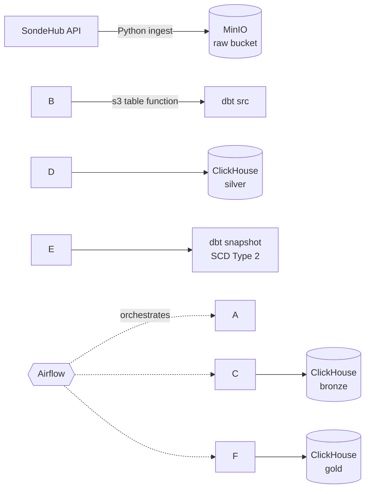

SondeHub Data Pipeline
An end-to-end data warehouse project: data from the SondeHub API is fetched with Python and written to MinIO, transformed with dbt into bronze / silver / gold layers on ClickHouse, and the whole flow runs automatically on Airflow. All services run in Docker.

Table of Contents
Architecture
Tech Stack
Project Structure
Data Layers
Getting Started
Airflow DAG
dbt Commands
Troubleshooting
Security
Architecture

Data flow:
Extract: A Python script (`api\_src/`) fetches data from the SondeHub API and writes it to the `raw` bucket in MinIO as Parquet files, partitioned into `ingest\_date=YYYY-MM-DD` folders.
Load: ClickHouse reads the files in MinIO directly through the `s3()` table function.
Transform: dbt moves the data through bronze → silver → gold. The gold layer contains a star schema with SCD Type 2 dimension tables.
Orchestrate: Airflow runs every step in order on a schedule.
Tech Stack
Component	Purpose
Python	Fetching data from the API and writing it to MinIO
MinIO	S3-compatible object storage (data lake)
ClickHouse	Analytical data warehouse
dbt (dbt-clickhouse)	Transformations, tests, snapshots
Airflow	Workflow scheduling and monitoring
Docker / Docker Compose	Running all services
Project Structure
```
Project/
├── airflow/
│   └── dags/                 # Airflow DAG files
├── api\_src/                  # Python code that fetches data from the API
├── dbt\_project/
│   ├── profiles/             # dbt profiles.yml (secrets via env\_var)
│   └── transform\_project/
│       ├── models/
│       │   ├── src/          # MinIO sources (ephemeral)
│       │   ├── bronze/       # raw data copy
│       │   ├── silver/       # cleaned, deduplicated data
│       │   └── gold/         # business models (dim / fact)
│       ├── snapshots/        # SCD Type 2 snapshot definitions
│       ├── macros/           # generate\_schema\_name, etc.
│       └── dbt\_project.yml
├── docs/
│   └── demo.gif              # demo animation shown in this README
├── Dockerfile
├── docker-compose.yml
├── requirements.txt
└── .env                      # secrets (not committed to Git)
```
Data Layers
Layer	ClickHouse database	Purpose
src	– (ephemeral)	Reads Parquet files from MinIO via `s3()`; does not create a table
bronze	`bronze`	Copy of the raw data plus audit columns (`loaded\_at`, `source\_file`, `partition\_date`)
silver	`silver`	Type casting, null handling, deduplication (`limit 1 by`)
gold	`gold`	Star schema: dimension and fact tables, SCD Type 2 history
SCD Type 2: Changes in dimension records are tracked with dbt snapshots. Each version has `dbt\_valid\_from` and `dbt\_valid\_to` columns, and the current record is identified by its `dbt\_valid\_to` value.
Getting Started
Prerequisites
Docker Desktop (WSL2 is recommended on Windows)
Git
1. Clone the repository
```bash
git clone <repository-url>
cd <project-folder>
```
2. Configure environment variables
Create a `.env` file in the project root:
```env
# ClickHouse
CH\_PASSWORD=

# MinIO
MINIO\_KEY=
MINIO\_SECRET=
```
Fill in the values for your own environment. This file must never be committed to Git.
3. Start the services
```bash
docker compose up -d --build
```
4. Open the web interfaces
Service	Address
Airflow	`http://localhost:8080`
MinIO console	`http://<host>:9001`
ClickHouse HTTP	`http://<host>:8123` (depends on your port mapping)
Ports depend on the mappings in `docker-compose.yml`. In MinIO, the API port (S3, used by ClickHouse and Python) is different from the console port (browser UI).
5. Prepare the MinIO bucket
Create a bucket named `raw` in the MinIO console. The Python script writes data into it under `ingest\_date=YYYY-MM-DD/` folders.
Airflow DAG
The DAG runs daily on a schedule in the following order:
```
ingest (Python)  →  dbt deps  →  dbt bronze  →  dbt silver  →  dbt snapshot  →  dbt gold  →  dbt test
```
In the Airflow UI, enable the DAG (toggle at the top left) and trigger it manually with the ▶ button if needed. If a task fails, downstream tasks do not run and the error can be inspected in the task log.
dbt Commands
To run dbt manually outside Airflow, from the `transform\_project` folder:
```bash
dbt deps                              # install packages
dbt run --select bronze               # bronze layer only
dbt run --select silver
dbt snapshot                          # SCD2 snapshots
dbt run --select gold
dbt test                              # data quality tests
dbt run --select +<model\_name>        # a model and all of its upstream models
dbt run --select <model\_name> --full-refresh   # rebuild an incremental table from scratch
```
Troubleshooting
Problem	Fix
`Could not list objects in bucket`	ClickHouse cannot reach the MinIO API port, or the path/port is wrong. Use the API port, not the console port (9001)
`Authentication failed` (ClickHouse)	Wrong password in `profiles.yml` or in the `CH\_PASSWORD` variable
`ingest\_date` column conflict	The Parquet file also contains a column with the same name. Disable hive partitioning and derive the date from `\_path`
Databases are created as `DWH\_bronze`	The `macros/generate\_schema\_name.sql` macro is missing
`dbt: command not found` (Airflow)	Rebuild the image with `--build`
DAG does not show up	Run `airflow dags list-import-errors` to see the import error
Security
Do not commit `.env`, `profiles.yml`, or any file containing passwords or keys (use `.gitignore`).
Use a dedicated, least-privilege dbt user in ClickHouse instead of the `default` user.
In MinIO, use an Access Key scoped to the required bucket instead of the root user.
Never write secrets in plain text in code or docs; use `env\_var()` instead.
License
This project is for educational and portfolio purposes.
